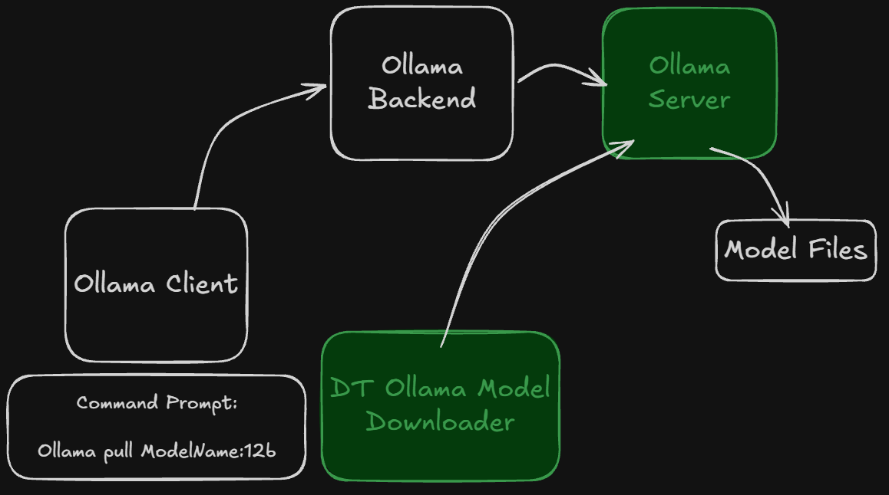

# DT (Dariush Tasdighi) - Ollama Model Downloader

## This program was developed by

- **Dariush Tasdighi**
  - Mobile Number: +98 912 108 7461
  - Email Address: <DariushT@GMail.com>
  - Telegram ID: <https://t.me/Dariush_Tasdighi>
  - Virgool: <https://virgool.io/@dariush-tasdighi>
  - Aparat: <https://www.aparat.com/IranianExperts>
  - LinkedIn: <https://www.linkedin.com/in/tasdighi>
  - Instagram: <https://www.instagram.com/dariushtasdighi>
  - Telegram Channels:
    - <https://t.me/IranianExperts>
    - <https://t.me/DT_PYTHON_LEARNING>

## Sponsor

[](https://pgpdc.ir)

### PGPDC - شرکت توسعه فناوری مدبران خلیج (همیشه) فارس

## Why

[](https://IranianExperts.ir)

## Used Packages

### 'rich' package

- <https://pypi.org/project/rich>
- <https://github.com/Textualize/rich>
- **More:**
  - <https://rich.readthedocs.io/en/latest>

### 'ollama' package

- <https://pypi.org/project/ollama>
- <https://github.com/ollama/ollama-python>
- **More:**
  - <https://ollama.com>

## Setup Environment

```bash
# python -m venv .venv
# .\.venv\Scripts\activate

# python -m pip list
# python -m pip install -r .\requirements.txt -U
# python -m pip list

# deactivate
```

```bash
# py install 3.13 -u

# py -3.13 -m venv .venv.3.13
# .\.venv.3.13\Scripts\activate

# python -m pip list
# python -m pip install -r .\requirements.3.13.txt -U
# python -m pip list

# deactivate
```

```bash
py install 3.14 -u

py -3.14 -m venv .venv.3.14
.\.venv.3.14\Scripts\activate

python -m pip list
python -m pip install -r .\requirements.3.14.txt -U
python -m pip list

deactivate
```

## Steps

- Install 'IDM' (Internet Download Manager)
- Update 'OLLAMA_PATH' in 'config.py'
- Update 'MODEL_FULL_NAME' in 'config.py'
- Start 'IDM'
- python step_1.py
- python step_2.py

---
